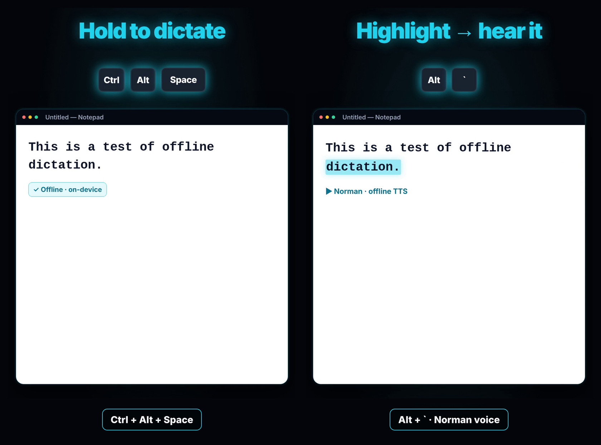
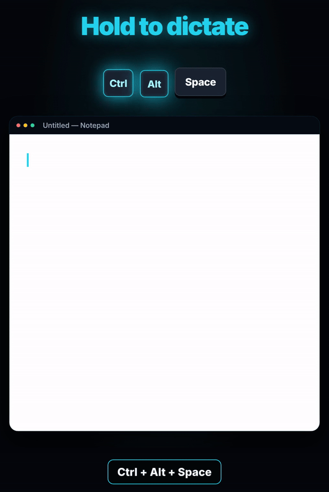

# SayTray

**Hear selected text read aloud, or hold a key and talk — your words are typed where the cursor is.**

SayTray is a free app for Windows and Mac. It sits in the system tray on Windows and the menu bar on Mac, and it stays on your computer.

- **Private and offline.** After a one-time voice download, what you read and what you dictate stays on your machine. No cloud.
- **Free.** No account and no subscription.
- **Windows and Mac.** One small icon, out of the way until you need it.
- **Read aloud and dictate.** Highlight text to hear it, or hold a key and speak to type.

## Download

**[Download SayTray 1.1.0 (free)](https://github.com/Jbizzle88/SayTray/releases/tag/v1.1.0)**

- [Windows — SayTray-1.1.0-Windows.zip](https://github.com/Jbizzle88/SayTray/releases/download/v1.1.0/SayTray-1.1.0-Windows.zip)
- [Mac — SayTray-1.1.0-macOS.zip](https://github.com/Jbizzle88/SayTray/releases/download/v1.1.0/SayTray-1.1.0-macOS.zip)





The pictures show the Windows shortcuts. On a Mac, hold **Option + Space** to dictate and press **Option + \`** to read.

## How to use

Unzip the download, then: on Windows double-click **Install.cmd**; on Mac double-click **Setup Piper Voices**, copy **SayTray.app** into Applications, and the first time right-click the app and choose **Open**. Both need Python 3.10 or newer for that setup step.

Two shortcuts are ready. You can change them later in Settings.

**Windows**

- **Read selected text:** press **Alt + \`** (Alt and the backtick key, just above Tab).
- **Dictate:** hold **Ctrl + Alt + Space**, speak, then let go. The words are typed at the cursor.

**Mac**

- **Read selected text:** press **Option + \`** (Option and the backtick key).
- **Dictate:** hold **Option + Space**, speak, then let go.

The first time you set it up, SayTray downloads two voices (about 170 MB): **Norman**, the default, and **LJSpeech**. More voices are optional and download from inside the app when you want them. After that, it works without the internet.

---

## Install notes

**Current source version:** 1.1.0

Build from source with the macOS and Windows READMEs. The v1.0.0 zip files on the GitHub release install an older voice set (including voices this build no longer ships) and are not the install for this version. The current public download is the [1.1.0 release](https://github.com/Jbizzle88/SayTray/releases/tag/v1.1.0), packaged with `package_release.sh` / `package_release.ps1`.

All releases: https://github.com/Jbizzle88/SayTray/releases

### First run (both platforms)

Piper voices are **not** inside the zip. Setup downloads two voices the first time (**about 170 MB**): **Norman (medium)**, the default, and **LJSpeech (high)**. More commercially licensed voices (Kristin, John, Cori, LibriTTS, Bryce, and Jenny (Dioco)) download later from the voice list inside the app. They are stored in your user Application Support / LocalAppData folder.

### macOS notes

1. Unzip, run **Setup Piper Voices**, copy `SayTray.app` to `~/Applications` (or `/Applications`).
2. **Gatekeeper:** the app is self-signed, not Apple-notarized. First open: **right-click → Open → Open**.
3. **Permissions** (System Settings → Privacy & Security): grant **Accessibility**, **Microphone**, and **Speech Recognition**.

Defaults: **⌥\`** read · **⌥Space** (hold) dictate.

### Windows notes

1. Unzip, double-click **Install.cmd** (needs Python 3.10+ on PATH).
2. Set your **real microphone** as the Windows default input (avoid Oculus/Steam virtual devices).
3. Appears in the tray + Start Menu; uninstall from Settings → Apps.

Defaults: **Alt+\`** read · **Ctrl+Alt+Space** (hold) dictate.

## Source layout

```
macos/     Swift package + build/package scripts
windows/   Python tray app + Install.cmd / install.ps1
dist/      Packaged zips (also attached to GitHub Releases)
```

Platform-specific install docs: [`macos/README.md`](macos/README.md), [`windows/README.md`](windows/README.md).  
How to cut a new release: [`macos/RELEASING.md`](macos/RELEASING.md) / [`windows/RELEASING.md`](windows/RELEASING.md).

## License

MIT — see [LICENSE](LICENSE). Piper (GPL-3.0-or-later), espeak-ng (GPL-3.0-or-later), and the voice models have their own licenses — see [THIRD_PARTY_NOTICES.md](THIRD_PARTY_NOTICES.md). LibriTTS is CC BY 4.0. The optional Irish/UK voice is labeled Jenny (Dioco).
