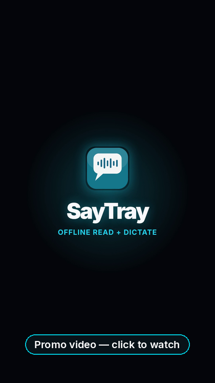

<p align="center">
  
</p>

<h1 align="center">SayTray</h1>

<p align="center"><strong>Hear selected text read aloud, or hold a key and talk — your words are typed where the cursor is.</strong></p>

<p align="center">A free app for Windows and Mac. It sits in the system tray or the menu bar, and it stays on your computer.</p>

<p align="center">
  <a href="https://github.com/Jbizzle88/SayTray/releases/latest"></a>
  <a href="https://github.com/Jbizzle88/SayTray/releases"></a>
  <a href="LICENSE"></a>
  <a href="#what-it-does"></a>
</p>

<p align="center">
  <a href="https://github.com/Jbizzle88/SayTray/releases/download/v1.1.0/SayTray-1.1.0-Windows.zip"></a>
  &nbsp;
  <a href="https://github.com/Jbizzle88/SayTray/releases/download/v1.1.0/SayTray-1.1.0-macOS.zip"></a>
</p>

<p align="center">
  Version 1.1.0 · <a href="https://github.com/Jbizzle88/SayTray/releases/tag/v1.1.0">release page</a><br>
  Windows 10 or 11, or macOS 14 or newer. Setup needs <a href="https://www.python.org/downloads/">Python 3.10 or newer</a>.
</p>

## What you get

These pictures are the real Mac app, not a drawing.


The menu shows **Read Selected Text** on **Option + \`**. While Norman is speaking, the menu bar icon turns into a speaker.

## What it does

- **Reads aloud.** Highlight text in almost any app and hear it.
- **Types what you say.** Hold a key, speak, let go. The words land at the cursor.
- **Stays on your computer.** No account and no subscription. After setup, it does not need the internet.
- **Sits out of the way.** Menu bar on Mac, system tray on Windows, until you press the shortcut.
- **Lets you choose.** Pick a voice, change the speed, and change the shortcuts in Settings.

## How to use

1. Download the zip for your computer (buttons above) and unzip it.
2. **Windows:** double-click **Install.cmd**.
3. **Mac:** double-click **Setup Piper Voices**, copy **SayTray.app** into your Applications folder, then right-click the app and choose **Open** the first time.
4. Highlight something, or hold the dictate key and talk. You can change both shortcuts in Settings.

**Windows**

- **Read selected text:** press **Alt + \`** (Alt and the backtick key, just above Tab).
- **Dictate:** hold **Ctrl + Alt + Space**, speak, then let go.

**Mac**

- **Read selected text:** press **Option + \`** (Option and the backtick key).
- **Dictate:** hold **Option + Space**, speak, then let go.

The first setup downloads two voices, about 170 MB: **Norman** (the default) and **LJSpeech**. On Windows it also downloads the Python packages and the local dictation model. More voices are optional and download from inside the app only if you ask for them.

## Questions

**Is it really offline?**

The setup step needs the internet once. After that, reading uses voices stored on your computer, and dictation runs locally (a speech model on Windows, Apple’s on-device recognition on a Mac that supports it). SayTray has no account, and it does not send what you highlight or what you say to a cloud service. An extra voice downloads only if you choose it.

**Is it free?**

Yes. No account and no subscription. SayTray’s own code is [MIT](LICENSE). The speech engine, Piper, is GPL, and the voices have their own terms. Those credits are in [THIRD_PARTY_NOTICES.md](THIRD_PARTY_NOTICES.md) and in the section at the bottom of this page.

**The Mac or Windows blocked it the first time. How do I open it?**

The Mac app is signed with a local certificate. It is **not** notarized by Apple, so macOS warns the first time and may say the developer cannot be verified. In Finder, **right-click SayTray.app → Open → Open**. After that, a normal double-click works. Then allow **Accessibility**, **Microphone**, and **Speech Recognition** when macOS asks (or in System Settings → Privacy & Security).

The Windows download is not code-signed. If SmartScreen says Windows protected your PC, click **More info**, then **Run anyway**, and continue with **Install.cmd**. Use your real microphone as the Windows default input. A virtual mic (Oculus, Steam, and similar) will make dictation hear silence.

**Which voices?**

**Norman (medium)** is the default: male, US. **LJSpeech (high)** comes with the first download: female, US. From the voice list you can add Kristin (female, US), John (male, US), Cori (female, UK), LibriTTS (three US speakers), Bryce (male, US), and Jenny (Dioco) (female, Irish/UK).

## 🎬 Promo video (illustrated, made with Grok Bot)

This is a short illustrated promo, not a recording of the app. The pictures above are the real Mac app. The drawings in the video use the Windows shortcuts. Click the image to watch.

[](docs/media/saytray-promo.mp4)

<details>
<summary><strong>Technical notes, build instructions, and licenses</strong></summary>

**Current source version:** 1.1.0

The public download is the [1.1.0 release](https://github.com/Jbizzle88/SayTray/releases/tag/v1.1.0) (`SayTray-1.1.0-Windows.zip` and `SayTray-1.1.0-macOS.zip`), packaged with `package_release.sh` / `package_release.ps1`. Older 1.0.0 packages installed a voice set this version no longer ships. Do not install those if you still have the files. They are not the current release.

Build from source with the macOS and Windows READMEs.

All releases: https://github.com/Jbizzle88/SayTray/releases

### First run (both platforms)

Piper voices are **not** inside the zip. Setup downloads two voices the first time (**about 170 MB**): **Norman (medium)**, the default, and **LJSpeech (high)**. More commercially licensed voices (Kristin, John, Cori, LibriTTS, Bryce, and Jenny (Dioco)) download later from the voice list inside the app. They are stored in your user Application Support / LocalAppData folder.

### macOS notes

1. Unzip, run **Setup Piper Voices**, copy `SayTray.app` to `~/Applications` (or `/Applications`).
2. **Gatekeeper:** the app is self-signed, not Apple-notarized. First open: **right-click → Open → Open**.
3. **Permissions** (System Settings → Privacy & Security): grant **Accessibility**, **Microphone**, and **Speech Recognition**.

Defaults: **⌥\`** read · **⌥Space** (hold) dictate.

Requires macOS 14 or newer, and [Python 3.10+](https://www.python.org/downloads/) for Setup Piper Voices.

### Windows notes

1. Unzip, double-click **Install.cmd** (needs Python 3.10+ on PATH).
2. Set your **real microphone** as the Windows default input (avoid Oculus/Steam virtual devices).
3. Appears in the tray + Start Menu; uninstall from Settings → Apps.

Defaults: **Alt+\`** read · **Ctrl+Alt+Space** (hold) dictate.

Requires Windows 10 or 11. The Windows zip is not code-signed.

### Source layout

```
macos/     Swift package + build/package scripts
windows/   Python tray app + Install.cmd / install.ps1
dist/      Packaged zips (also attached to GitHub Releases)
```

Platform-specific install docs: [`macos/README.md`](macos/README.md), [`windows/README.md`](windows/README.md).  
How to cut a new release: [`macos/RELEASING.md`](macos/RELEASING.md) / [`windows/RELEASING.md`](windows/RELEASING.md).

### License

MIT — see [LICENSE](LICENSE). Piper (GPL-3.0-or-later), espeak-ng (GPL-3.0-or-later), and the voice models have their own licenses — see [THIRD_PARTY_NOTICES.md](THIRD_PARTY_NOTICES.md). LibriTTS is CC BY 4.0. The optional Irish/UK voice is labeled Jenny (Dioco).

</details>
